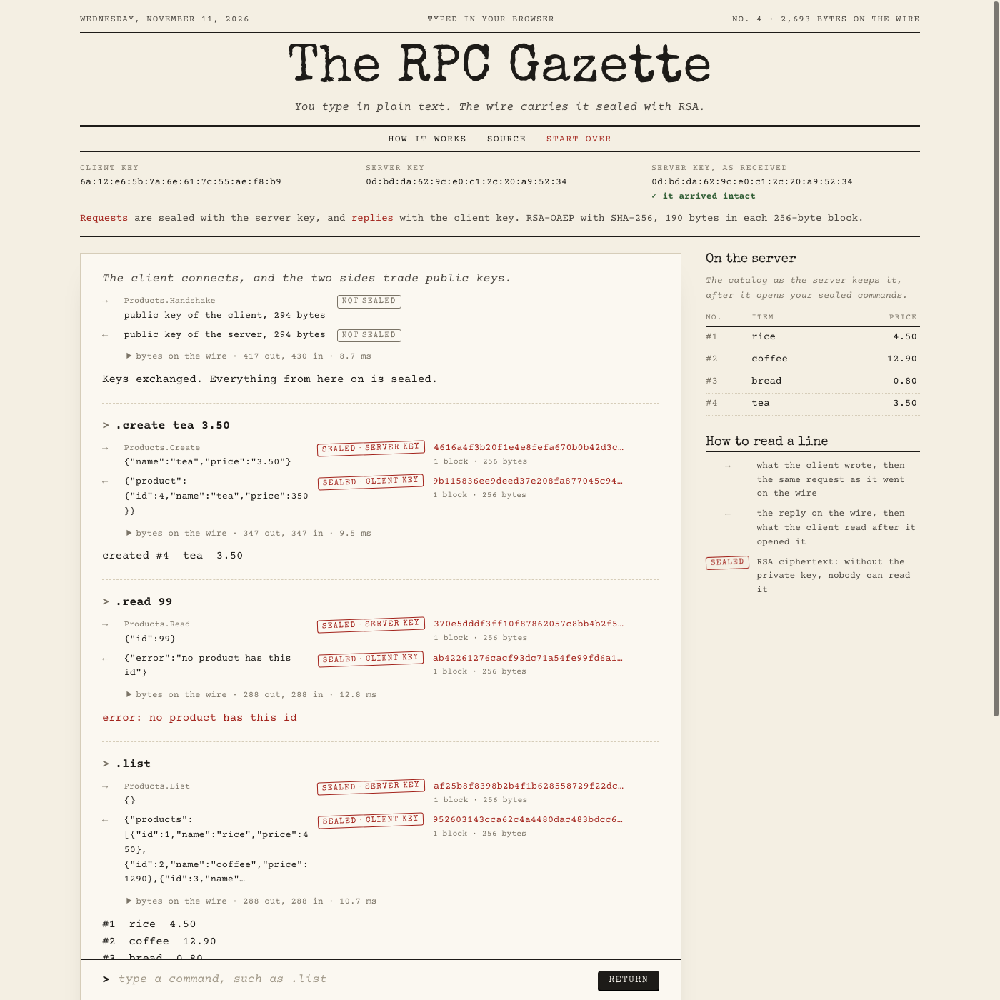

# The RPC Gazette

A product catalog server in Go, with Go `net/rpc` over TCP. Every request and every reply is sealed with RSA. The project has a server, a command-line client, and The RPC Gazette. The RPC Gazette is a page in the style of a typewriter. It runs the same server and client in your browser. For each command that you type, it shows the plaintext next to what goes on the wire.

[](https://github.com/rahelmartim/go-rpc-rsa-crud/actions/workflows/ci.yml)
[](https://rahelmartim.github.io/go-rpc-rsa-crud/)
[](https://go.dev)



Each command on the sheet shows its sealed request and its sealed reply. To try it, open the [live demo](https://rahelmartim.github.io/go-rpc-rsa-crud/).

## How it works

1. The client and the server each make a 2048-bit RSA key pair.
2. The client calls `Products.Handshake` with its public key, and the server replies with its own public key. Public keys are not secret, so this call is not sealed. The server refuses keys smaller than 2048 bits.
3. For each command, the client writes the request as JSON, such as `{"name":"tea","price":"3.50"}`. It encrypts the request with the public key of the server (RSA-OAEP with SHA-256), and calls a method such as `Products.Create`.
4. The server opens the request with its private key, runs it on the catalog, and writes the result as JSON. It encrypts the result with the public key of the client. Errors, such as an unknown id, are inside the sealed result too.
5. The client opens the reply with its private key.

One RSA block holds 190 bytes of a message. A longer message, such as a long list, is cut into blocks, and each block is encrypted on its own.

Someone who reads the wire sees the method names, such as `Products.Create`, because `net/rpc` sends them in plain text. The arguments and the results are sealed.

## Limits

This project shows how RSA works. It is not a secure protocol.

- The handshake does not prove who the server is. Someone in the middle can send their own key. Compare the fingerprints of the keys to find this.
- The blocks of one message are encrypted one by one, so someone in the middle can remove or reorder blocks.
- Real protocols use RSA only to agree on a key, and then they encrypt the messages with a fast cipher such as AES-GCM. TLS does this.

## The page

```bash
make serve
```

Then open http://localhost:8080. To use another port, run `make serve PORT=8090`.

Type a command on the sheet, such as `.create tea 3.50`. For each call, the sheet shows two lines:

- `→` what the client wrote, and the same request sealed with the server key, as it went on the wire
- `←` the reply sealed with the client key, as it came from the wire, and what the client read after it opened it

To see the bytes that `encoding/gob` wrote on the connection, open "bytes on the wire" under a command. To recall an earlier command, use the arrow keys. To empty the sheet, type `.clear`.

## The server and the client over TCP

Start the server in one terminal:

```bash
go run ./cmd/server
```

The server listens on `127.0.0.1:1234`. To change the address, use `-addr`.

Then start the client in another terminal:

```bash
go run ./cmd/client
```

The client reads one command on each line:

```text
.create <name> <price>        add a product, such as .create rice 4.50
.read <id>                    show one product
.update <id> <name> <price>   change a product
.delete <id>                  remove a product
.list                         show all products
.help                         show this list
.quit                         close the connection
```

Names in the command line cannot have spaces. Use `brown_rice` instead.

The server has no login, and it keeps the catalog in memory only. Do not expose it to a network that you do not trust.

## Tests

```bash
make test                                        # Go tests with the race detector
make web && node --test web/test/gazette.test.js  # browser tests (needs Chrome)
```

| Package | What the tests cover |
| --- | --- |
| `catalog` | CRUD, names and prices, the size limit, and use from many goroutines. |
| `keys` | Encryption, the label, messages of many blocks, changed or foreign blocks, bad and weak keys, and fingerprints. |
| `service` | The handshake first, CRUD, sealed errors, requests that the server cannot open, and no plaintext on the wire. Long replies in many blocks, and 6 clients over TCP at the same time. |
| `client` | Every command of the command line, its errors, and the trace of a call. |
| `gazette` | The handshake, both seals of a command, the bytes on the wire, errors, long lists, and a new connection. |
| `web/test` | The page in a headless Chrome: the stamps, the ciphertext on the wire, errors, the commands, and no JavaScript errors. |

## Project structure

```text
catalog/            # The products, in memory, safe for many connections
keys/               # RSA keys, fingerprints, and sealed messages (RSA-OAEP)
service/            # The RPC service: a handshake, then sealed calls
client/             # The RPC client and the command line
gazette/            # A server and a client in one process, with a record of each call
cmd/server/         # The TCP server
cmd/client/         # The command-line client
cmd/gazette-wasm/   # The WebAssembly entry point of the page
web/                # The page, and its browser tests
```

## History

This project started in 2017 as a university exercise: a `net/rpc` CRUD with an RSA login. In 2026, it was rebuilt with the same commands. The rebuild seals every call instead of only the login. It also fixed these problems of the first version:

- One login opened the server for every client.
- A bad command made the server stop.
- The server wrote the password in its log.

## License

This project uses the MIT license. Read the [LICENSE](LICENSE) file for the full text.
