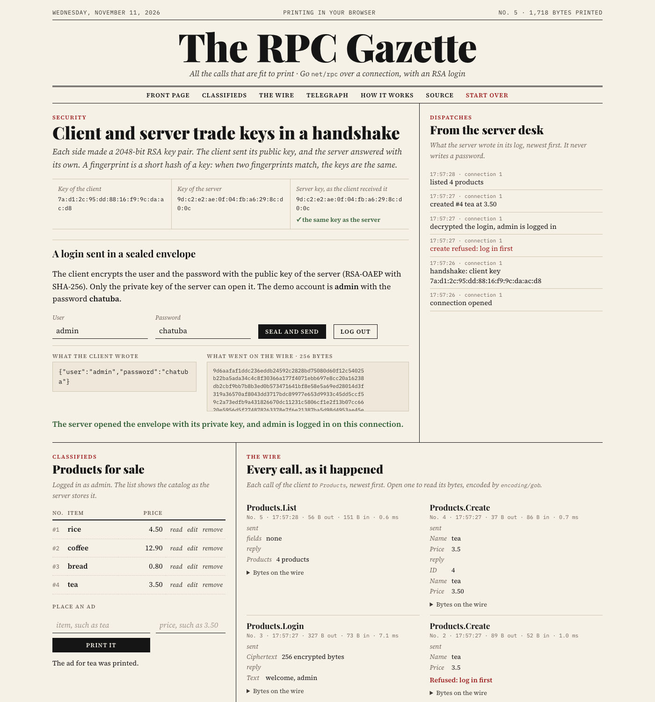

# The RPC Gazette

A product catalog server in Go, with Go `net/rpc` over TCP and a login that is encrypted with RSA. It has a server, a command-line client, and The RPC Gazette. The RPC Gazette is a page in the style of a newspaper. It runs the same server and client in your browser, and it prints every call with its bytes on the wire.

[](https://github.com/rahelmartim/go-rpc-rsa-crud/actions/workflows/ci.yml)
[](https://rahelmartim.github.io/go-rpc-rsa-crud/)
[](https://go.dev)

The live demo is at https://rahelmartim.github.io/go-rpc-rsa-crud/.



## What it does

- **Handshake:** the client and the server each make a 2048-bit RSA key pair, and they trade public keys with `Products.Handshake`.
- **Sealed login:** the client encrypts the user and the password with the public key of the server (RSA-OAEP with SHA-256). Only the private key of the server can open the message.
- **CRUD:** after the login, the client calls `Products.Create`, `Read`, `Update`, `Delete`, and `List`.
- **Sessions:** a login is valid only on its own connection. Each connection can fail the login three times.
- **The page:** it shows the key fingerprints, the login before and after the encryption, the catalog, and the log of the server. It also shows each call with its arguments, its reply, and a hex dump of its bytes. A command line runs the commands of the original client.

## How it works

The client connects, and then makes these calls in this order:

1. `Products.Handshake` sends the public key of the client in the PKIX format. The server keeps it for the connection and replies with its own public key. The server refuses keys smaller than 2048 bits.
2. `Products.Login` sends `{"user": "...", "password": "..."}` as JSON, encrypted with the key of the server. The ciphertext is 256 bytes, and it is different each time. The server compares hashes of the user and the password in constant time.
3. The CRUD calls. Without a login on this connection, the server refuses them with `log in first`.

`net/rpc` encodes each call with `encoding/gob`. Gob sends the definition of a type the first time that the connection uses the type, so the first call of each kind is larger. The page shows this in the byte counts.

Only the login is encrypted. The product calls travel in plain text. To protect them, put the connection inside TLS.

## Getting started

You need Go 1.24 or later.

### The page

```bash
make serve
```

Then open http://localhost:8080. To use another port, run `make serve PORT=8090`. In the page, the demo account is `admin` with the password `chatuba`.

### The server and the client over TCP

Start the server in one terminal:

```bash
RPC_PASSWORD=choose-a-password go run ./cmd/server
```

If `RPC_PASSWORD` is not set, the server makes a random password and prints it. The server listens on `127.0.0.1:1234`. To change the address, use `-addr`. To change the user name (`admin`), use `-user`.

Then start the client in another terminal:

```bash
go run ./cmd/client
```

The client reads one command on each line:

```text
.login <user> <password>     log in (the message is encrypted with RSA)
.create <name> <price>        add a product, such as .create rice 4.50
.read <id>                    show one product
.update <id> <name> <price>   change a product
.delete <id>                  remove a product
.list                         show all products
.logout                       end the login
.help                         show this list
.quit                         close the connection
```

Names in the command line cannot have spaces. Use `brown_rice` instead.

The server has no TLS and keeps the catalog in memory only. Do not expose it to a network that you do not trust.

## Tests

```bash
make test                                        # Go tests with the race detector
make web && node --test web/test/gazette.test.js  # browser tests (needs Chrome)
```

| Package | What the tests cover |
| --- | --- |
| `catalog` | CRUD, names and prices, the size limit, and use from many goroutines. |
| `keys` | Encryption and decryption, the label, changed ciphertexts, bad and weak keys, and fingerprints. |
| `service` | The order of the calls, wrong passwords, and the limit of tries. Sessions for each connection, and bad ciphertexts. No password in the log or on the wire. 6 clients over TCP at the same time. |
| `client` | Every command of the command line, and its errors. |
| `gazette` | The calls and their bytes, the login view, the gob type definitions, and a new connection. |
| `web/test` | The page in a headless Chrome: the handshake, refused calls, the login, the bytes on the wire, the ads, the command line, and no JavaScript errors. |

## Project structure

```text
catalog/            # The products, in memory, safe for many connections
keys/               # RSA keys, fingerprints, and RSA-OAEP
service/            # The RPC service, with one session for each connection
client/             # The RPC client and the command line
gazette/            # A server and a client in one process, with a record of each call
cmd/server/         # The TCP server
cmd/client/         # The command-line client
cmd/gazette-wasm/   # The WebAssembly entry point of the page
web/                # The page, and its browser tests
```

## History

This project started in 2017 as a university exercise: a `net/rpc` CRUD with an RSA login. In 2026, it was rebuilt with the same commands and the same idea. The rebuild fixed these problems of the first version:

- One login opened the server for every client.
- A bad command made the server stop.
- The server wrote the password in its log.
- The password was in the code.

## License

This project uses the MIT license. Read the [LICENSE](LICENSE) file for the full text.
